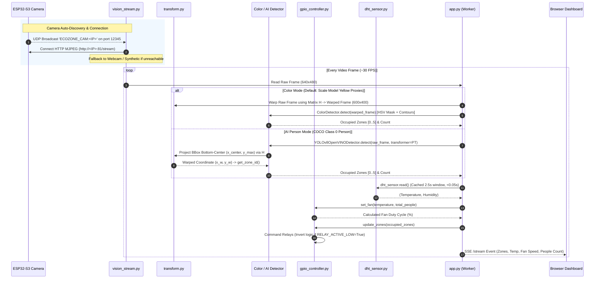

# MASTER SYSTEM ARCHITECTURE SPECIFICATION
**Project Name:** EcoZone AI - Smart Energy Management via Edge AI & Spatial Mapping  
**Target Hardware:** Raspberry Pi 4 Model B (4GB RAM) & ESP32-S3 Camera  
**OS:** Raspberry Pi OS 64-bit (Debian Trixie, Headless / Console Mode)  
**Python Version:** 3.10+  

---

## 1. OVERVIEW & HARDWARE SPECIFICATIONS

### 1.1. Physical Constraints & Grid Layout
* **Model Dimensions:** $30\text{ cm}$ (Width) $\times$ $40\text{ cm}$ (Depth).
* **Zone Grid Layout:** 3 Rows $\times$ 2 Columns (6 Zones total, each $15\text{ cm (Width)} \times 13.33\text{ cm (Depth)}$).
  * **Zone 0:** Row 0, Col 0 (Top-Left) $\vert{}$ **Zone 1:** Row 0, Col 1 (Top-Right)
  * **Zone 2:** Row 1, Col 0 (Mid-Left) $\vert{}$ **Zone 3:** Row 1, Col 1 (Mid-Right)
  * **Zone 4:** Row 2, Col 0 (Bottom-Left) $\vert{}$ **Zone 5:** Row 2, Col 1 (Bottom-Right)
* **Warped Digital Canvas:** $600\text{ px}$ (Width) $\times$ $400\text{ px}$ (Height).
* **Cell Dimensions:** Each cell is exactly $300\text{ px}$ (Width) $\times$ $133.33\text{ px}$ (Height).
* **Camera Rig:** ESP32-S3 mounted overhead at $50\text{ cm} - 55\text{ cm}$ height, pitch angle $65^\circ - 75^\circ$.
* **Primary Power:** External 5V - 10A DC Power Supply (Separated Logic & Load lines, Common GND across Pi, Relay Board, L298N, and DC supply).

### 1.2. Physical Zone Grid Mapping

```text
+------------------------------+------------------------------+
|            ZONE 0            |            ZONE 1            |
|   Row 0, Col 0 (Top-Left)    |   Row 0, Col 1 (Top-Right)   |
|   Canvas: [0..300, 0..133]   |  Canvas: [300..600, 0..133]  |
+------------------------------+------------------------------+
|            ZONE 2            |            ZONE 3            |
|   Row 1, Col 0 (Mid-Left)    |   Row 1, Col 1 (Mid-Right)   |
|  Canvas: [0..300, 133..266]  | Canvas: [300..600, 133..266] |
+------------------------------+------------------------------+
|            ZONE 4            |            ZONE 5            |
|  Row 2, Col 0 (Bottom-Left)  |  Row 2, Col 1 (Bottom-Right) |
|  Canvas: [0..300, 266..400]  | Canvas: [300..600, 266..400] |
+------------------------------+------------------------------+
```

---

## 2. HIGH-LEVEL SYSTEM ARCHITECTURE

```mermaid
graph TB
    subgraph Input_Layer ["Khối Đầu Vào (Input Layer)"]
        ESP["ESP32-S3 Camera Node<br/>(UDP 12345 Discovery & MJPEG)"]
        FALLBACK["Local Webcam / Synthetic<br/>(Cascading Auto-Fallback)"]
        DHT["DHT11 Sensor (GPIO 4)<br/>(2.5s Cached Non-Blocking)"]
    end

    subgraph Processing_Layer ["Khối Xử Lý Trung Tâm (Raspberry Pi 4)"]
        VS["core/vision_stream.py<br/>(Stream Decoder & Fallback Cascade)"]
        PT["core/transform.py<br/>(Homography Perspective Transform)"]
        CALIB["Web Calibration (/calibrate)<br/>(Dynamic 4-Point Homography H)"]
        CDET["core/color_detector.py<br/>(HSV Yellow Filter on Warped Frame)"]
        AIDET["core/detector.py<br/>(YOLOv8 OpenVINO on Raw Frame)"]
        CTRL["hardware/gpio_controller.py<br/>(Relay Active-LOW & PWM Fan)"]
        WEB["app.py<br/>(Flask SSE Server & REST API)"]
    end

    subgraph Output_Layer ["Khối Chấp Hành & Hiển Thị (Output & Display)"]
        RELAY["6-Channel Relay Module<br/>(GPIO 17, 27, 22, 23, 24, 25)"]
        LEDS["6x 5V-10W LED Zones<br/>(Normally Open Relay Contacts)"]
        FAN["L298N Driver + DC Fan<br/>(Hardware PWM GPIO 18)"]
        DASH["Web Dashboard<br/>(SSE /stream & HUD Overlay)"]
    end

    ESP -->|Broadcast UDP:12345| VS
    ESP -->|MJPEG Stream :81/stream| VS
    FALLBACK -.->|Fallback Stream| VS
    DHT -->|1-Wire GPIO 4| CTRL
    VS -->|Raw Frame 640x480| PT
    VS -->|Raw Frame 640x480| AIDET
    VS -->|Raw Snapshot| CALIB
    CALIB -->|Save Matrix H| PT
    PT -->|Warped Frame 600x400| CDET
    AIDET -->|Project Anchor via H| PT
    CDET -->|Zone Occupancy [0..5]| CTRL
    AIDET -->|Zone Occupancy [0..5]| CTRL
    CTRL -->|Digital Output Low/High| RELAY
    RELAY -->|Switched 5V Power| LEDS
    CTRL -->|PWM Duty Cycle 1000Hz| FAN
    CDET -->|Telemetry JSON| WEB
    AIDET -->|Telemetry JSON| WEB
    CTRL -->|Environment & Fan JSON| WEB
    WEB -->|Server-Sent Events /stream| DASH
```

---

## 3. DIRECTORY STRUCTURE

```text
smart_building/
├── app.py                      # Flask Server, Background Worker Thread & REST Endpoints
├── config.py                   # Pinout Mapping, Grid Constants, Path Anchors, Polarity Flags
├── requirements.txt            # Standard Development Dependencies (with pytest)
├── requirements-pi.txt         # Raspberry Pi OS Dependencies (rpi-lgpio, headless opencv)
├── perspective_matrix.npy      # Saved 3x3 Homography Matrix (Auto-anchored)
├── calibration.py              # CLI/GUI Calibration & 4-Point Homography Computation
├── setup_model.py              # YOLOv8 Model Downloader & OpenVINO IR Exporter
├── run_tests.py                # Pytest Test Suite Runner with JSON Reporting
├── core/
│   ├── __init__.py
│   ├── color_detector.py       # HSV Yellow Marker Detection on Warped Frame
│   ├── detector.py             # YOLOv8 OpenVINO Person Detection on Raw Frame
│   ├── stream.py               # MJPEG Stream Response Generators
│   ├── transform.py            # Perspective Transformation & 3x2 Grid Spatial Mapping
│   └── vision_stream.py        # Multi-Source Video Stream & UDP Camera Discovery
├── hardware/
│   ├── __init__.py
│   ├── gpio_controller.py      # Relay Zone Actuator (Active-LOW) & L298N PWM Fan Driver
│   └── dht_sensor.py           # Non-Blocking Cached (<0.05s) DHT11 Sensor Driver
├── models/
│   ├── yolov8n.pt              # Base PyTorch Weights
│   └── yolov8n_openvino_model/ # OpenVINO IR Model (yolov8n.xml, yolov8n.bin)
├── scripts/
│   ├── setup_pi.sh             # Automated Raspberry Pi 4 Deployment Script
│   └── ecozone.service         # Systemd Background Service Unit File
├── templates/
│   ├── index.html              # HTML5/JS Real-Time Monitoring Dashboard
│   └── calibrate.html          # Web-Based Interactive 4-Point Perspective Calibration UI
├── tests/                      # Comprehensive 227+ Automated Test Suite
└── esp32_firmware/
    └── esp32_cam_server/       # ESP32-S3 Arduino Firmware (UDP Beacon + MJPEG)
        ├── esp32_cam_server.ino
        ├── config.h
        ├── wifi_secrets.h      # Local WiFi Credentials (Git-ignored)
        └── wifi_secrets.example.h
```

---

## 4. HARDWARE PINOUT MAPPING (`config.py`)

| Component | Physical Header Pin | BCM GPIO Pin | Direction / Mode | Active Logic |
| :--- | :--- | :--- | :--- | :--- |
| **Zone 0 Relay** | Header Pin 11 | `GPIO 17` | OUTPUT (Digital) | Active-LOW (`0V` = ON, `3.3V` = OFF) |
| **Zone 1 Relay** | Header Pin 13 | `GPIO 27` | OUTPUT (Digital) | Active-LOW (`0V` = ON, `3.3V` = OFF) |
| **Zone 2 Relay** | Header Pin 15 | `GPIO 22` | OUTPUT (Digital) | Active-LOW (`0V` = ON, `3.3V` = OFF) |
| **Zone 3 Relay** | Header Pin 16 | `GPIO 23` | OUTPUT (Digital) | Active-LOW (`0V` = ON, `3.3V` = OFF) |
| **Zone 4 Relay** | Header Pin 18 | `GPIO 24` | OUTPUT (Digital) | Active-LOW (`0V` = ON, `3.3V` = OFF) |
| **Zone 5 Relay** | Header Pin 22 | `GPIO 25` | OUTPUT (Digital) | Active-LOW (`0V` = ON, `3.3V` = OFF) |
| **L298N ENA (Fan PWM)** | Header Pin 12 | `GPIO 18` | Hardware PWM | $1000\text{ Hz}$ ($0\% - 100\%$ Duty Cycle) |
| **L298N IN1 (Direction)** | Header Pin 29 | `GPIO 5` | OUTPUT (Digital) | `HIGH` (Forward Rotation) |
| **L298N IN2 (Direction)** | Header Pin 31 | `GPIO 6` | OUTPUT (Digital) | `LOW` |
| **DHT11 Data Line** | Header Pin 7 | `GPIO 4` | INPUT (Pull-up) | 1-Wire Digital Signal |
| **Relay Logic VCC** | Header Pin 2 or 4 | $5\text{V}$ Rail | POWER | Logic VCC (Pi $5\text{V}$ or External $5\text{V}$) |
| **Sensor VCC** | Header Pin 1 | $3.3\text{V}$ Rail | POWER | Logic VCC ($3.3\text{V}$ safe for DHT11) |
| **Common Ground** | Header Pin 6 / 9 / 14 | `GND` | GROUND | Tied with external power supplies |

---

## 5. END-TO-END DATA PIPELINE & SEQUENCE



---

## 6. TECHNICAL MODULE SPECIFICATIONS

### 6.1. Perspective Transform & 3×2 Spatial Grid (`core/transform.py`)

* **Input:** Raw camera frame ($640 \times 480\text{ px}$) captured from angled overhead camera.
* **Source Points ($S$):** 4 corner coordinates selected via Web Calibration UI (`/calibrate`):
  $$S = [(x_1, y_1), (x_2, y_2), (x_3, y_3), (x_4, y_4)]$$
* **Destination Points ($D$):** Standard rectangular bird's-eye canvas:
  $$D = [(0, 0), (600, 0), (600, 400), (0, 400)]$$
* **Homography Matrix ($H$):** $3 \times 3$ matrix calculated via `cv2.getPerspectiveTransform(S, D)` and persisted to `perspective_matrix.npy`.
* **Output Canvas:** Warped frame of size $600 \times 400\text{ px}$.
* **Grid Subdivision:** 3 Rows $\times$ 2 Columns.
  * Cell Width: $W_{\text{cell}} = 600 / 2 = 300\text{ px}$.
  * Cell Height: $H_{\text{cell}} = 400 / 3 \approx 133.33\text{ px}$.
* **Zone Assignment Formulation:**
  For any point $(x, y)$ on the $600 \times 400$ canvas:
  $$\text{Col} = \max\left(0, \min\left(1, \left\lfloor \frac{x}{300} \right\rfloor\right)\right)$$
  $$\text{Row} = \max\left(0, \min\left(2, \left\lfloor \frac{y}{133.33} \right\rfloor\right)\right)$$
  $$\text{Zone ID} = \text{Row} \times 2 + \text{Col} \quad (\text{clamped to } [0, 5])$$

### 6.2. Dual Detection Pipeline (`core/color_detector.py` vs `core/detector.py`)

EcoZone AI incorporates a Dual Detection Engine tailored for both physical scale-model demonstrations and real-world human occupancy:

| Metric / Attribute | Color Mode (`ColorDetector`) | AI Mode (`YOLOv8OpenVINODetector`) |
| :--- | :--- | :--- |
| **Primary Target** | Yellow stickers, cups, markers (Scale model proxies) | Human occupants (`person`, COCO class ID `0`) |
| **Input Coordinate Frame**| Warped Bird's-Eye Frame ($600 \times 400$) | Raw Angled Camera Frame ($640 \times 480$) |
| **Core Method** | HSV Color Filtering & Morphological Contours | Deep Learning YOLOv8n via OpenVINO IR (`FP16`) |
| **HSV Range** | Lower: `[20, 100, 100]`, Upper: `[35, 255, 255]` | N/A |
| **Confidence / Min Area**| `min_contour_area = 500.0` pixels | `conf_threshold = 0.35`, `valid_class_ids = [0]` |
| **Anchor Mapping** | Contour center/bottom $(c_x, c_y)$ evaluated directly | BBox bottom-center $(x_{\text{center}}, y_{\text{max}})$ mapped via $H$ |
| **Latency on Pi 4** | $< 5\text{ ms}$ (Ultra-low CPU overhead) | $60 - 80\text{ ms}$ (OpenVINO optimized ARM NEON) |
| **Mode Toggling** | `POST /set_mode` with `{"mode": "color"}` | `POST /set_mode` with `{"mode": "ai"}` |

### 6.3. Web-Based Perspective Calibration (`calibration.py` & `app.py`)

To eliminate manual matrix editing or external GUI dependencies on headless Raspberry Pi installations, EcoZone AI provides an interactive browser-based calibration workflow:
* `GET /calibrate`: Interactive HTML5 Canvas UI presenting the current live frame.
* `GET /calibrate/snapshot`: Captures the latest unwarped $640 \times 480$ camera frame.
* `POST /calibrate/save`: Receives 4 JSON point coordinates `[[x1,y1], [x2,y2], [x3,y3], [x4,y4]]` clicked in clockwise order (Top-Left $\to$ Top-Right $\to$ Bottom-Right $\to$ Bottom-Left). Calculates homography $H$ and atomically writes `perspective_matrix.npy`.
* `POST /calibrate/reset`: Restores the transformation to identity matrix.

### 6.4. Vision Streaming & UDP Camera Discovery (`core/vision_stream.py`)

* **UDP Auto-Discovery:** ESP32-S3 broadcasts a UDP beacon on port `12345` with payload `ECOZONE_CAM:<IP>` upon acquiring WiFi. `VisionStream` listens asynchronously and dynamically configures the stream URL to `http://<IP>:81/stream`.
* **Cascading Auto-Fallback:** If the ESP32 camera is offline or disconnected:
  1. Attempts local USB webcam (`webcam_index = 0`).
  2. Attempts pre-recorded video file (`video_path`).
  3. Activates synthetic frame generator (`source_type = "synthetic"`).
  * Setting `FORCE_ESP32_ONLY=1` disables fallback cascade when strict physical hardware testing is required.

### 6.5. Hardware Actuation & Relay Polarity (`hardware/gpio_controller.py`)

* **6-Channel Relay Driver:** Controls 6 isolated zones powered by external $5\text{V} - 10\text{A}$ power.
* **Configurable Relay Polarity (`RELAY_ACTIVE_LOW`):**
  * **Commercial Optocoupled Relays (`RELAY_ACTIVE_LOW=True` / `1`):**
    * Boot/Idle state: `GPIO.HIGH` ($3.3\text{V}$) $\implies$ Relay coil de-energized (Zone OFF).
    * Occupied state: `GPIO.LOW` ($0\text{V}$) $\implies$ Optocoupler activates, relay closes (Zone ON).
  * **Direct Breadboard LEDs (`RELAY_ACTIVE_LOW=False` / `0`):**
    * Boot/Idle state: `GPIO.LOW` ($0\text{V}$) $\implies$ LED OFF.
    * Occupied state: `GPIO.HIGH` ($3.3\text{V}$) $\implies$ LED ON.
* **L298N DC Fan PWM Control:**
  * Hardware PWM on `GPIO 18` at $1000\text{ Hz}$.
  * Formula:
    $$\text{Duty Cycle (\%)} = \begin{cases} 0 & \text{if } \text{Total Occupants} = 0 \\ \min\left(100, \max\left(30, 40 + (\text{Temp} - 25) \times 5 + \text{People Count} \times 10\right)\right) & \text{if } \text{Total Occupants} > 0 \end{cases}$$

### 6.6. Environmental Sensing (`hardware/dht_sensor.py`)

* **Sensor:** DHT11 Digital Temperature & Humidity Sensor on `GPIO 4`.
* **Non-Blocking Caching Window:**
  * Hardware reads are throttled by `min_interval = 2.5` seconds. Calls within the interval immediately return `self.last_valid_reading` in $< 0.1\text{ ms}$.
* **Failure Recovery:**
  * No blocking `time.sleep()` in polling path.
  * In case of 1-wire timing CRC failure, logs at DEBUG level and immediately falls back to `last_valid_reading`, completing execution in $< 0.05\text{ s}$ without pipeline stalling.
* **Resource Teardown:** Integrates with `app.py` SIGINT/SIGTERM handlers via `dht_sensor.cleanup()` to avoid `libgpiod` line lockups.

### 6.7. Real-Time Web Dashboard & SSE Protocol (`app.py`)

* **Transport:** Server-Sent Events (`text/event-stream`) via endpoint `GET /stream`.
* **Telemetry JSON Structure:**
  ```json
  {
    "zones": [1, 0, 0, 1, 0, 0],
    "temp": 28.5,
    "humidity": 62.0,
    "fan_speed": 70,
    "total_people": 2,
    "mode": "color",
    "timestamp": 1775822400
  }
  ```
* **REST Endpoints:**
  * `POST /set_mode`: Switch detection mode (`{"mode": "color" | "ai"}`).
  * `GET /video_feed`: MJPEG stream with HUD overlay and zone boundary grids.
  * `GET /raw_feed`: Raw unwarped camera MJPEG stream for alignment.
  * `GET /debug_feed`: Diagnostic mask view (HSV binary mask or OpenVINO confidence overlay).
