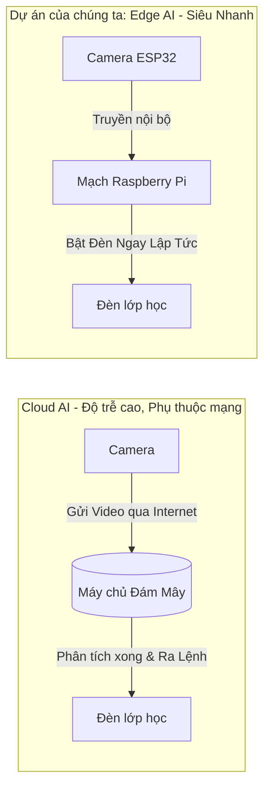

# Cẩm Nang ECO-ZONE - Phần 1: Tổng quan & Khái niệm Cốt lõi

Chào mừng các em đến với dự án **ECO-ZONE**. Chắc hẳn khi nghe đến những từ khóa như "AI", "OpenVINO", "YOLOv8", nhiều bạn sẽ cảm thấy choáng ngợp. Đừng lo! Phần 1 này sẽ giúp các em hiểu tường tận bản chất của chúng thông qua những ví dụ cực kỳ gần gũi.

---

## 1. Vấn đề dự án giải quyết là gì?

Thử tưởng tượng các không gian sinh hoạt chung (Public spaces) như Khu vực tự học, Thư viện trường, Hội trường hoặc Căn tin. Đây là những nơi ai cũng có thể vào sử dụng và tự tay bật công tắc đèn, quạt tùy thích. Nhưng vấn đề đau đầu là: **Không có ai túc trực ở đó 24/24 để đi theo tắt điện khi mọi người đã ra về hết.** Việc để người dùng tự giác tắt thiết bị ở không gian công cộng là rất khó, dẫn đến hệ thống điện cứ bật sáng trưng lãng phí cả ngày.

Nhiều nơi giải quyết bằng cách gắn **Cảm biến chuyển động (PIR)**. Nhưng PIR có một điểm yếu chí mạng: Nó chỉ bắt được "chuyển động". Khi các em đang ngồi im lặng tập trung đọc sách, PIR tưởng góc đó không có người nên... tự động cúp cầu dao tắt đèn. Rất ức chế đúng không?

**Giải pháp của chúng ta:** Dùng Camera kết hợp Trí tuệ nhân tạo (AI) để đếm chính xác số người và tọa độ ngồi của họ. Bạn ngồi im cũng không sao, AI nhận ra "hình dáng con người" và chỉ bật đèn/quạt đúng khu vực bạn đang ngồi.

---

## 2. Edge AI (AI tại biên) là gì?

Dự án của chúng ta được gọi là một dự án **Edge AI**. Vậy nó khác gì với ChatGPT hay các AI khác?

* **Hình ảnh so sánh:** Hãy tưởng tượng em có một bài toán khó. Thay vì đóng gói bài toán đó, gửi bưu điện nhờ các giáo sư giải rồi chờ gửi thư kết quả lại (đó là cách Cloud AI hoạt động), thì em có ngay một **"Trợ lý thông minh"** đứng cạnh mình có thể giải bài toán đó ngay lập tức (Edge AI).
* **Định nghĩa:** Edge AI là việc đưa trí tuệ nhân tạo chạy trực tiếp trên các thiết bị tại chỗ (như mạch Raspberry Pi, camera).
* **Ưu điểm siêu việt của dự án mình:** 
  1. Phản xạ siêu nhanh (Bật/tắt đèn ngay lập tức).
  2. Hoàn toàn **KHÔNG cần Internet**.
  3. Bảo mật 100%: Hình ảnh camera quay trong lớp học không bao giờ bị gửi lên mạng.

---

## 3. YOLOv8 - Đôi mắt của dự án

* **Hình ảnh so sánh:** Nếu các thuật toán AI cũ giống như việc em cầm kính lúp dò dẫm từng centimet của một bức tranh để tìm xem có con người nào không (rất chậm), thì YOLO giống như một học sinh siêu phàm chỉ cần **"Nhìn Lướt Qua Một Lần" (You Only Look Once)** là có thể khoanh tròn mọi vật thể trong tranh ngay lập tức.
* **Định nghĩa:** YOLOv8 là một thuật toán AI thế hệ mới nhất chuyên dùng để Nhận diện vật thể (Object Detection). Nó quét toàn bộ bức ảnh cùng lúc và vẽ ra các khung chữ nhật (Bounding Box) bao quanh người với tốc độ cực nhanh, đủ để chạy mượt mà trên các mạch điện tử nhỏ gọn.

---

## 4. Raspberry Pi vs ESP32

Trong sa bàn dự án, các em sẽ thấy 2 mạch điện tử chính. Chúng làm gì?

* **Raspberry Pi (Bộ não trung tâm):** Giống như một **"Người Quản Lý"**. Rất thông minh, có hệ điều hành riêng (Raspberry Pi OS), có thể gánh được những việc nặng nhọc như chạy mô hình AI YOLOv8. Nhưng "quản lý" thì ăn nhiều điện và giá thành đắt.
* **ESP32 Camera (Mắt thần):** Giống như một **"Công Nhân Chăm Chỉ"**. ESP32 là một vi điều khiển (Microcontroller) không có hệ điều hành. Nó sinh ra để làm đúng một việc: Quay video và phát sóng video đó qua mạng Wi-Fi nội bộ. "Công nhân" này ăn rất ít điện, giá cực kỳ rẻ (chỉ hơn 100 ngàn đồng).

**Tại sao phải kết hợp cả hai?**
Thay vì kéo một sợi cáp USB dài thượt từ Camera cắm vào Raspberry Pi (rất xấu và giới hạn khoảng cách), chúng ta dùng ESP32 làm Camera không dây treo tít trên trần nhà. Mạch Raspberry Pi sẽ được giấu gọn gàng trong hộp kỹ thuật, kết nối Wi-Fi với ESP32 để kéo hình ảnh về xử lý AI. Một kiến trúc cực kỳ chuyên nghiệp và tối ưu chi phí!

---
👉 **Xong Phần 1!** Ở phần tiếp theo, chúng ta sẽ đi sâu vào xem luồng dữ liệu (Data flow) chạy trong hệ thống thực tế diễn ra như thế nào nhé. Mở file `02_giai_phau_kien_truc.md`!
