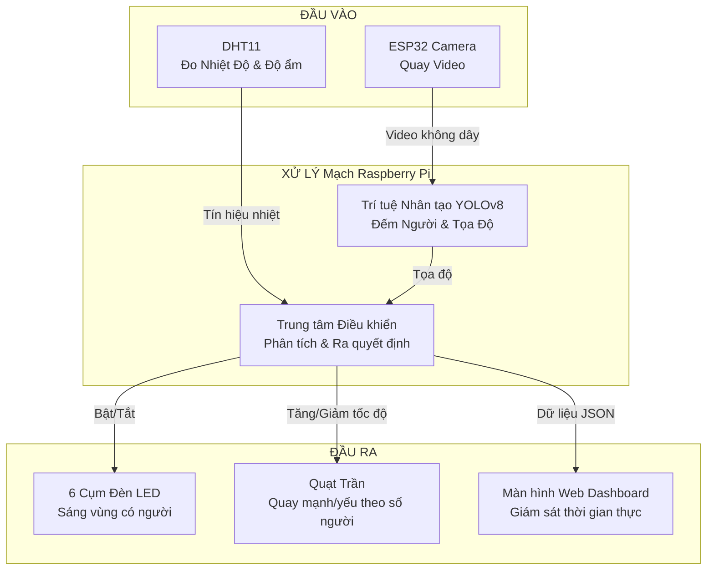
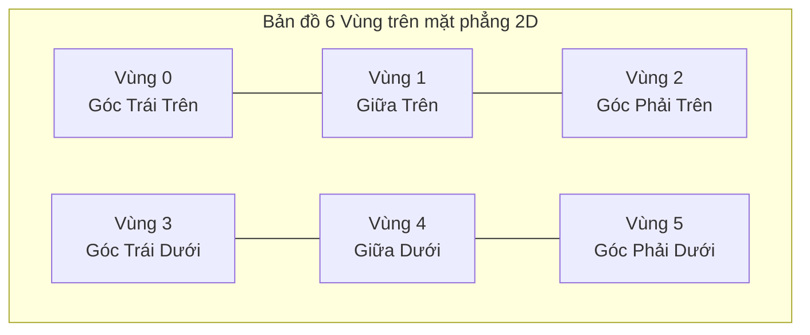

# Cẩm Nang ECO-ZONE - Phần 2: Giải phẫu Kiến trúc Hệ thống

Chào các em! Ở phần trước, chúng ta đã hiểu các khái niệm bề nổi. Bây giờ, chúng ta sẽ "mổ xẻ" dự án ECO-ZONE để xem bên trong nó hoạt động như thế nào nhé. Đừng lo, mọi thứ được thiết kế rất logic.

---

## 1. Sơ đồ Luồng Dữ Liệu (Mạch máu của hệ thống)

Hệ thống của chúng ta hoạt động theo nguyên tắc cơ bản nhất của mọi loại máy móc: **ĐẦU VÀO -> XỬ LÝ -> ĐẦU RA**.

* **Khối Đầu Vào (Input):** Thu thập bối cảnh bằng Camera và cảm biến.
* **Khối Xử Lý (Bộ não):** Dùng AI đếm người, sau đó đưa qua khối Logic để tính toán: Khu vực nào cần bật đèn? Nhiệt độ đang là bao nhiêu để quay quạt mạnh hay yếu?
* **Khối Đầu Ra (Output):** Xuất tín hiệu điện ra phần cứng và cập nhật lên trang Web.

---

## 2. Nắn phẳng góc nhìn - Thuật toán Perspective Transform

Các em thử nghĩ xem: Camera thường được treo ở góc trần nhà và nhìn chéo xuống. Khi nhìn chéo, mọi thứ sẽ bị méo (gần thì to, xa thì nhỏ). Vậy làm sao AI biết chính xác người đó đang ngồi ở ô số mấy trên mặt sàn?

**Giải pháp:** Dự án sử dụng một thuật toán gọi là **Nắn phẳng phối cảnh (Perspective Transform)**.
1. Chúng ta sẽ chọn 4 điểm góc của căn phòng trên màn hình camera.
2. Thuật toán sẽ "kéo giãn" và nắn bức ảnh chéo đó thành một bản đồ mặt phẳng 2D thẳng đứng (giống như góc nhìn của loài chim bay từ trên trời nhìn thẳng xuống sàn nhà).
3. Từ bản đồ 2D phẳng phiu này, chúng ta dùng những đường kẻ dọc và ngang để chia lớp học thành **6 Vùng (Zone)** đều nhau.

Giờ thì ai ngồi ở ô nào, AI cũng gọi tên chính xác Vùng đó và ra lệnh bật đèn!

---

## 3. Tại sao dự án có "Chế độ Kép" (Dual Detection Mode)?

Nếu các em để ý trong Code của dự án, hệ thống không chỉ có mỗi nhận diện người bằng AI (YOLO) mà còn có "Chế độ màu sắc" (Color Mode). Vì sao lại vậy?

* **Chế độ AI (Nhận diện Người):** Đây là chế độ chạy chính thức (Production). Rất thông minh, nhưng đòi hỏi sức mạnh xử lý lớn.
* **Chế độ Màu (Color Mode):** Nhận diện các vật thể có màu vàng/cam bằng toán học cơ bản, cực kỳ nhẹ.
* **Lý do có 2 chế độ:** Trong quá trình gỡ lỗi (debug) phần cứng, việc có một chế độ siêu nhẹ như Color Mode giúp các em dễ dàng kiểm tra xem Camera có đang hoạt động tốt không, thuật toán chia 6 vùng có chuẩn không mà không cần phải chờ load mô hình AI nặng nề. Chuyển đổi giữa 2 chế độ này chỉ tốn vài mili-giây trên trang Web!

---

## 4. Bảng điều khiển siêu đẹp (Glassmorphism Dashboard)

Trang web quản lý của hệ thống được thiết kế theo phong cách **Glassmorphism** (hiệu ứng kính mờ). Đây là xu hướng giao diện hiện đại nhất hiện nay.
Trang web này sử dụng công nghệ **Server-Sent Events (SSE)**. Nghĩa là ngay khi AI phát hiện có người bước vào Vùng 1, lập tức Vùng 1 trên màn hình Web của các em sẽ sáng lên. Mọi thứ đồng bộ theo thời gian thực (real-time) mà không cần phải tải lại trang Web!

---
👉 **Xong Phần 2!** Các em đã hiểu rõ cấu trúc của đồ án chưa? Ở phần 3 cuối cùng, chúng ta sẽ xem cách "nhúng" đống code này vào mạch Raspberry Pi như thế nào nhé. Mở file `03_thuc_hanh_va_trien_khai.md`!
