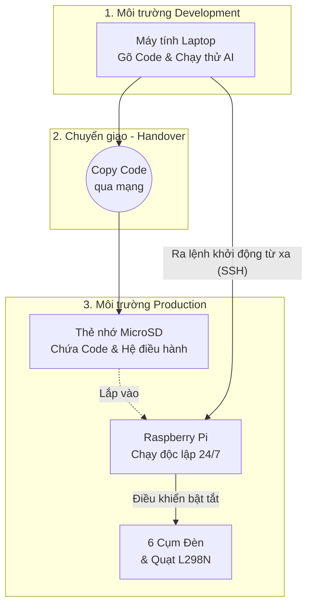
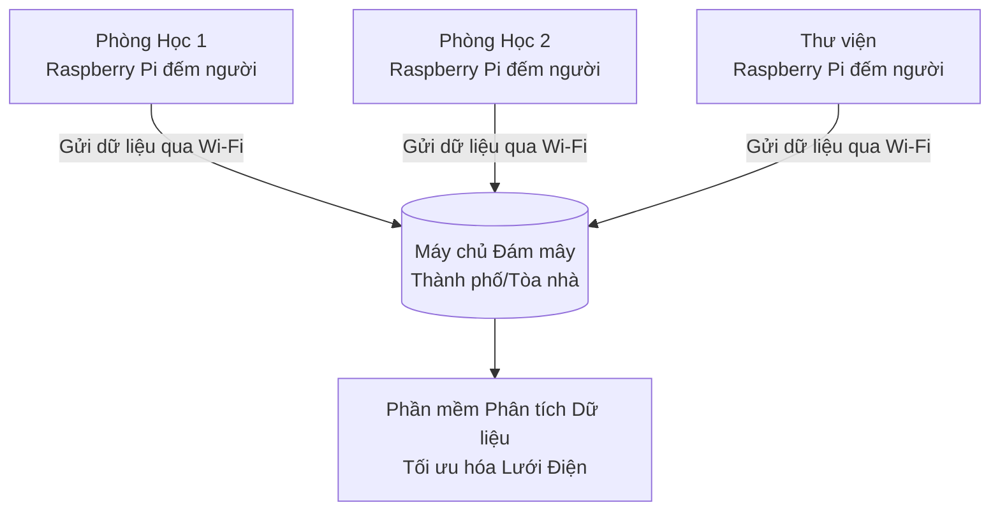

# Cẩm Nang ECO-ZONE - Phần 3: Thực hành, Triển khai & Kế hoạch

Chào các em đến với chặng cuối của bộ cẩm nang. Ở phần này, chúng ta sẽ giải quyết một câu hỏi rất lớn mà các nhóm làm đồ án hay gặp phải: *"Code xong trên máy tính rồi thì làm sao nhét nó vào cái mạch Raspberry Pi nhỏ xíu kia?"*

---

## 1. Hành trình của Code: Từ Laptop sang Raspberry Pi

Rất nhiều bạn lầm tưởng là chúng ta cắm cáp USB vào Raspberry Pi rồi ấn nút "Run" trên Laptop. KHÔNG PHẢI VẬY! 

Raspberry Pi thực chất là một **máy tính hoàn chỉnh** thu nhỏ. Nó có RAM, CPU, và một khe cắm thẻ nhớ MicroSD đóng vai trò như "ổ cứng" lưu hệ điều hành. Mã nguồn sẽ được copy sang thẻ nhớ và chạy trực tiếp trên Pi một cách độc lập.

### Chi tiết các bước:
1. **Trên Laptop:** Đây là nơi các em gõ code (dùng VSCode) và chạy thử sức mạnh AI bằng Card đồ họa của máy tính. Hiện tại, source code của dự án đã hoàn thiện 100% ở bước này.
2. **Chuyển giao:** Dùng các công cụ truyền file qua mạng (như WinSCP, FileZilla hoặc Github) để copy toàn bộ code từ Laptop thả vào hệ điều hành (Raspberry Pi OS) nằm trên thẻ MicroSD.
3. **Vận hành trên Pi:** Từ Laptop, các em mở phần mềm điều khiển từ xa (gọi là SSH) để ra lệnh cho Pi chạy file `app.py`. Kể từ giờ phút này, Laptop của các em có thể cất đi, Pi sẽ tự nhận ảnh từ Camera và điều khiển sa bàn vĩnh viễn!

---

## 2. Quy trình Cài đặt & Canh chỉnh Sa bàn

Khi lắp ráp thực tế, việc quan trọng nhất không phải là bật máy lên, mà là **Canh chỉnh (Calibration)**. Nếu camera đặt sai góc, AI sẽ nhận diện lệch hết các vùng.

**Quy trình chuẩn bị:**
1. **Lắp ráp cứng:** Treo camera ESP32 lên cao, cấp nguồn. Cắm các chân tín hiệu của đèn LED và Relay L298N vào đúng chân GPIO trên Raspberry Pi theo sơ đồ đã định.
2. **Nắn góc bằng giao diện:** Mở trang Web quản lý, vào mục `calibrate.html`. Hệ thống sẽ chụp 1 ảnh thực tế từ Camera. Em dùng chuột click chọn đúng 4 góc của căn phòng trên bức ảnh đó. Thuật toán sẽ tự "nắn thẳng" ảnh lại để chia lưới 6 vùng chính xác.
3. **Chạy thử (Testing):** Kích hoạt hệ thống AI, thử đi qua đi lại giữa các vùng để kiểm tra đèn. (Nếu muốn test nhanh không chờ AI load, em bật "Chế độ Màu sắc - Color Mode", cầm một vật màu vàng quơ qua quơ lại để test phần cứng bật tắt đèn).

---

## 3. Tầm nhìn Tương lai - Đô thị Thông minh (Smart Building)

Hệ thống ECO-ZONE của chúng ta có một định hướng vĩ mô hơn rất nhiều so với một phòng học nhỏ.

* **Hiện tại (Local Edge):** Mạch Raspberry Pi đang tự xử lý và chỉ điều khiển được phòng của nó.
* **Tương lai (IoT Cloud):** Mạch Pi sẽ đóng gói số liệu (Hôm nay phòng A dùng bao nhiêu điện, có bao nhiêu người) và gửi lên một Máy chủ Đám mây (Cloud) lớn. 
* Từ dữ liệu của hàng ngàn căn phòng gửi về, Ban quản lý Đô thị Thông minh sẽ nắm được thói quen sử dụng điện của người dân, từ đó có chính sách phân phối lưới điện hiệu quả nhất, tránh quá tải cục bộ.

**Lời kết:**
Dự án ECO-ZONE không chỉ là một chiếc công tắc thông minh. Nó là sự kết tinh giữa Phần cứng (IoT), Phần mềm (Web) và Trí tuệ nhân tạo (AI). Nắm vững các kiến thức trong bộ Cẩm nang này, các em sẽ tự tin trả lời bất kỳ câu hỏi phản biện nào! Chúc cả Team bứt phá!
